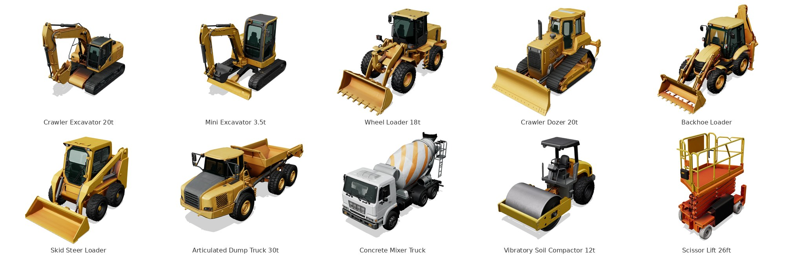

# Construction Equipment

Ten construction machines generated with hi3D: textured, PBR-material 3D models
scaled to real-world size. They complement the CAD models in
[`../construction_site`](../construction_site), which has the telehandler, line
pump, compressor, mixer and site furniture.

## Formats

| File | Use | Units |
|---|---|---|
| `<name>.glb` | Blender, Sketchfab, game engines, web viewers, the model library. One textured mesh with PBR materials (8K base colour and metal/roughness maps). | metres, Y up |
| `<name>_preview.png` | Thumbnail shown in the model library | |
| `reference/<name>_views.jpg` | The front / back / left / right images hi3D built the model from | |

Every model faces **+Z** (glTF's forward), is centred on X/Z and stands on the
ground at Y = 0, so they can be dropped into a scene together at true scale.
Each is about 2 million triangles and 50 MB. These are visualisation meshes, not
CAD: there are no separate parts and no STEP files.

## Assets

| # | Asset | Size (L × W × H) | Scaled by | Pose and notes |
|---|---|---|---|---|
| 01 | Crawler Excavator (20 t) | 20.6 × 9.8 × 15.2 ft (6.28 × 2.99 × 4.63 m) | width over tracks, 2.99 m | Boom raised, arm tucked, bucket curled. Length and height are for this pose. |
| 02 | Mini Excavator (3.5 t) | 11.1 × 5.7 × 7.7 ft (3.39 × 1.74 × 2.34 m) | width over tracks and blade, 1.74 m | Rubber tracks, enclosed cab, dozer blade down, arm tucked. |
| 03 | Wheel Loader (18 t) | 24.0 × 9.7 × 11.9 ft (7.31 × 2.95 × 3.62 m) | bucket width, 2.95 m | Bucket carried low. About 12% shorter than a typical 18 t loader (≈ 8.3 m). |
| 04 | Crawler Dozer (20 t) | 19.1 × 10.8 × 10.6 ft (5.83 × 3.30 × 3.23 m) | blade width, 3.30 m | Semi-U blade down, three-shank ripper raised. About 10% shorter than typical (≈ 6.4 m with ripper). |
| 05 | Backhoe Loader | 19.5 × 7.7 × 11.3 ft (5.94 × 2.35 × 3.43 m) | loader bucket width, 2.35 m | Loader bucket low, backhoe folded for travel, stabilisers up. |
| 06 | Skid Steer Loader | 10.6 × 6.0 × 6.8 ft (3.24 × 1.83 × 2.08 m) | 72 in bucket, 1.83 m | Bucket flat on the ground, enclosed cab. |
| 07 | Articulated Dump Truck (30 t) | 33.8 × 11.6 × 12.8 ft (10.30 × 3.55 × 3.90 m) | length, 10.3 m | 6×6, body down. Width includes the mirrors. About 10% taller than typical (≈ 3.5 m). |
| 08 | Concrete Mixer Truck | 28.9 × 11.7 × 16.2 ft (8.80 × 3.57 × 4.92 m) | length, 8.8 m | 3-axle with drum, hopper, chute, water tank and ladder. Width includes the mirrors. **About 25% taller than a real 8–9 m³ mixer (≈ 4.0 m).** |
| 09 | Vibratory Soil Compactor (12 t) | 19.2 × 8.5 × 12.0 ft (5.85 × 2.59 × 3.66 m) | length, 5.85 m | Single smooth drum, ROPS canopy. About 20% taller (≈ 3.0 m) and 10% wider (≈ 2.3 m) than typical. |
| 10 | Scissor Lift (26 ft) | 8.0 × 4.7 × 8.9 ft (2.44 × 1.43 × 2.71 m) | stowed length, 2.44 m | Electric slab lift, stowed, deck retracted. About 20% wider (≈ 1.2 m) and taller (≈ 2.3 m stowed) than a real 26 ft slab lift. |

## 1:50 painted 3MFs (work in progress)

`print_1-50/<name>_1-50_painted.3mf` is each machine at 1:50 as one solid
piece, painted per triangle for a multi-colour printer (Bambu Studio,
OrcaSlicer and Snapmaker Orca read the paint), in three or four of the stock
filaments of Construction Site Packs 1-4. **They have not been test-printed
yet.** `python construction_equipment/make_prints.py` builds them from the
real-size GLBs (about 2 minutes and 5 GB of memory per machine): it simplifies
the mesh, thickens anything under 0.8 mm, flattens the bottom, pegs loose
pieces to the body and paints from the texture. It also writes a plain STL and
a painted preview GLB of each, which are left out of git for size.

Cab windows are painted from what the texture shows through the glass, so some
come out as a patchwork of black and body colour; fill them in the slicer's
paint tool if that matters.

| Machine | At 1:50 (L × W × H) | Filaments, T1-T4 |
|---|---|---|
| Crawler Excavator 20t | 126 × 60 × 93 mm | Black, Construction yellow, Silver grey |
| Mini Excavator 3.5t | 68 × 36 × 47 mm | Black, Construction yellow, Silver grey |
| Wheel Loader 18t | 147 × 59 × 72 mm | Construction yellow, Black, Silver grey |
| Crawler Dozer 20t | 117 × 66 × 64 mm | Construction yellow, Black, Silver grey |
| Backhoe Loader | 119 × 48 × 69 mm | Construction yellow, Black, Silver grey |
| Skid Steer Loader | 65 × 37 × 42 mm | Construction yellow, Black, Silver grey |
| Articulated Dump Truck 30t | 206 × 71 × 78 mm | Construction yellow, Black, Silver grey |
| Concrete Mixer Truck | 176 × 72 × 98 mm | Black, White, Silver grey, Safety orange |
| Vibratory Soil Compactor 12t | 117 × 52 × 73 mm | Black, Construction yellow, Silver grey |
| Scissor Lift 26ft | 49 × 29 × 54 mm | Safety orange, Black, Construction yellow, Silver grey |

## How accurate the sizes are

Each model is scaled by **one** dimension that doesn't depend on its pose:
the width over the tracks or bucket for the earthmovers, and the overall length
for the trucks, roller and lift. Those values are typical published figures
for the class, not one manufacturer's. The other two dimensions come from the
model's own proportions, and the notes above flag the ones that differ from
typical specs by more than about 10%.

The trucks, roller and scissor lift come out tall. The AI-generated reference
images draw them slightly chunky, and hi3D follows the images. They are fine
for visualisation and rough layout, but **don't use them for overhead
clearance or swing-radius checks**. Use the CAD models in `construction_site`,
or a manufacturer's drawing, for that.

The machines are unbranded: the prompts asked for no logos, text or decals.

## How they were made

1. **Reference views:** hi3D text-to-image (Nano-Banana 2, multi-view), one
   prompt per machine, giving a matched front, back, left and right view.
   Construction yellow, plain studio background, a simple stowed or travel pose.
   The side views didn't always come back in the same order, so each set was
   put in front / back / left / right order, with "left" showing the front
   pointing left, before modelling.
2. **3D:** hi3D image-to-3D, v3.0 high quality, textured, PBR, from all four
   views.
3. **Scale:** `python construction_equipment/scale_models.py` wraps each model
   in one root node that turns, scales, centres and grounds it. Only the GLB's
   JSON chunk is rewritten. The mesh and textures stay byte-for-byte what hi3D
   returned, and re-running the script replaces its own node rather than
   stacking another. The dimension and value used for each machine are the
   `MACHINES` table at the top of the script.
4. **Previews:** `node construction_equipment/render_previews.cjs` renders each
   thumbnail in headless Chromium with the same three.js version the model
   library uses. It needs Playwright and internet access.

Cost: 8 points per reference set and 45 per model, so 530 hi3D points for the
ten.

They are on Cults3D as Construction Site Pack 5: the textured GLBs (one eighth
of the triangles, 2K textures) as the main download, and the painted 3MFs as a
work-in-progress extra.

| Asset | hi3D reference task | hi3D model |
|---|---|---|
| Crawler Excavator 20t | `e258105baf524f74bc39f2908b0529f3` | [78b26d29…](https://www.hi3d.ai/3d-model/78b26d29cd0c480e93291aa8751ba2e4) |
| Mini Excavator 3.5t | `c5620b08cff94d21bb4116900d8323a6` | [a5b21710…](https://www.hi3d.ai/3d-model/a5b2171012274d70915980a672971185) |
| Wheel Loader 18t | `925aad7c0ee74600967bb483ee8c08e4` | [e4dc7b3a…](https://www.hi3d.ai/3d-model/e4dc7b3afd504a2f9f03e2799f4279bd) |
| Crawler Dozer 20t | `740fa5e12b0e498193748eed56fb35dc` | [eaeb2de6…](https://www.hi3d.ai/3d-model/eaeb2de6beb54edda63ca4df337e4350) |
| Backhoe Loader | `dfdd3819457c46b4b21395e9aee8b70c` | [28cd938b…](https://www.hi3d.ai/3d-model/28cd938b5ea24679bd92f7497bf9309d) |
| Skid Steer Loader | `13da1585d0d5410abc7c3ab990b5c61e` | [1b53fbf7…](https://www.hi3d.ai/3d-model/1b53fbf7ed8147e794b3eea43dd9156c) |
| Articulated Dump Truck 30t | `e2f32172c8384150babe5705f9cede05` | [b156c97e…](https://www.hi3d.ai/3d-model/b156c97ec45e4e89a37217bcbbb61109) |
| Concrete Mixer Truck | `e1b04f57e410423da7cf7dc98e5b9489` | [1da6bf7b…](https://www.hi3d.ai/3d-model/1da6bf7b2f3a48fb8035a2a6c9fb81ec) |
| Vibratory Soil Compactor 12t | `d645075cd64a4e09bb4e75b4f8cb1456` | [c31b5bd2…](https://www.hi3d.ai/3d-model/c31b5bd20097438d94fac0c94fac3736) |
| Scissor Lift 26ft | `9f5add9b18104ead8de678066d1955df` | [7b27a4b6…](https://www.hi3d.ai/3d-model/7b27a4b6953642fa8611e87eaa55e093) |

The hi3D models are private to the account that made them.
