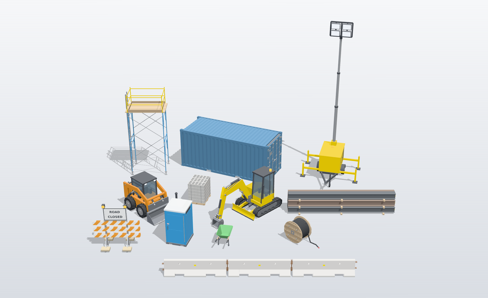

# Construction Site Assets

26 construction-site models built to real-world dimensions, for site planning, layout drawings, visualisation and 3D printing: the original 13 (01–13) and a second set (14–26) that also comes as print-ready 1:50 STLs.

## Formats

| File | Use | Units |
|---|---|---|
| `.step` | CAD (Shapr3D, Fusion 360, SolidWorks, Onshape, FreeCAD). Every part is a separate, coloured solid that can be edited. | millimetres |
| `.glb` | Sketchfab, web viewers, Blender, game engines. Colours included. | metres (glTF standard) |
| `_preview.png` | Thumbnail shown in the model library | |

All models sit on the ground at true scale. STL versions are in the downloadable asset pack.

## Assets

| # | Asset | Size (L × W × H) | Description | Suggested tags |
|---|---|---|---|---|
| 01 | Trailer Concrete Line Pump | 20.0 × 7.9 × 8.5 ft | Twin-axle trailer line pump: engine enclosure with exhaust/DPF canister, rear hopper with grille, outlet reducer, outrigger legs, tow tongue and jack. | concrete-pump, line-pump, trailer, construction-equipment |
| 02 | Towable Air Compressor | 16.6 × 6.1 × 7.5 ft | Large portable diesel compressor on a twin-axle trailer: louvred service doors, lifting eye, exhaust, control panel, drawbar and jockey wheel. | air-compressor, towable, diesel, construction-equipment |
| 03 | Roll-Off Dumpster (20 yd) | 20 × 8 × 5.1 ft | Open-top roll-off bin: sloped front, rim rail, side ribs, rear swing door with hinges and latch, runners, rollers and cable hook. Hollow inside. | dumpster, roll-off, waste-bin, construction-site |
| 04 | Pallet of Concrete Bags | 4.1 × 3.3 × 2.6 ft | 48 × 40 in wooden pallet with 27 bagged-concrete sacks (24 × 16 × 4.5 in) stacked in an interlocking 6-layer pattern. | concrete-bags, pallet, cement, building-materials |
| 05 | Planetary Concrete Mixer (500 L) | 5.5 × 5.7 × 6.5 ft | Planetary countercurrent pan mixer, 500 L dry fill: pan, conical cover, inspection hatch, gear drive and motor, discharge gate, water ring and supports. | concrete-mixer, planetary-mixer, batching-plant |
| 06 | Mixer Stand | 7.1 × 7.1 × 5.1 ft | Steel portal-frame stand for a pan mixer: 150 mm square-tube legs, deep top frame with slots, corner gussets, cross beams, tie bars, base plates on timber blocks. | steel-stand, support-frame, structural-steel |
| 07 | Planetary Mixer on Stand | 7.1 × 7.1 × 11.0 ft | Assets 05 and 06 combined, with the mixer discharging between the stand's cross beams. | concrete-mixer, mixing-station |
| 08 | Telehandler (10,000 lb / 56 ft class) | 28.6 × 8.5 × 8.5 ft | Telescopic handler, boom stowed: two-section boom with lift and tilt cylinders, open-sided cab, side engine bay, counterweight, front stabilisers, 400/75-28 tyres, 48 in carriage with 72 in forks. | telehandler, telescopic-handler, forklift, construction-equipment |
| 09 | Traffic Cone (28 in) | 14 × 14 in × 28 in | Standard road cone, square black base and two reflective collars. | traffic-cone, safety, road-works |
| 10 | Industrial Steel Stair (12 ft) | 15.4 × 3.5 × 15.4 ft | 45° industrial stair: channel stringers, grating treads with nosings, pipe handrails (yellow and white), top landing with guard rail. | stairs, industrial-stair, steel-structure |
| 11 | Temporary Fence Panel (6 × 10 ft) | 10.6 × 2.1 × 6.2 ft | Galvanised chain-link construction fence panel on steel stands. | construction-fence, temporary-fencing, chain-link |
| 12 | Temporary Fence Run (50 ft) | 50.7 × 2.1 × 6.2 ft | Five clamped fence panels on shared stands. | construction-fence, temporary-fencing, site-hoarding |
| 13 | Rail Crossover Gantry | 29.0 × 25.9 × 27.5 ft | Pedestrian crossover over a rail track: two X-braced lattice towers, a truss walkway bridge with grating deck (23 ft clear underneath), and a 50° stair up one side. The track runs along Y at X = 0. | rail, crossover, pedestrian-bridge, gantry, industrial |

## Notes

- These are simplified models (accurate envelope and layout, not manufacturer replicas) intended for planning and visualisation.
- Chain-link mesh is modelled at 100 mm wire spacing (real 2 in mesh is too dense to model as solids).
- Some dimensions (stair height, crossover clearance, mixer stand) are typical values rather than a specific site's.

---

## Set 2 (14–26): plant, site facilities and materials



Built by `build_assets.py`, so every one can be regenerated, re-posed or exported at another print scale. Each comes as:

| File | Use | Units |
|---|---|---|
| `<Name>.step` | CAD. Every part a separate, coloured solid. | millimetres |
| `<Name>.glb` | Web viewers, Blender, game engines. Coloured, one mesh per part. | metres |
| `print_1-50/<Name>_1-50.stl` | 3D printing at 1:50. One closed, connected body, flat on the bed. | millimetres |
| `<Name>_preview.png`, `print_1-50/<Name>_1-50_preview.png` | Studio renders for listings | |

| # | Asset | Full size (L × W × H) | At 1:50 (mm) | Description | Suggested tags |
|---|---|---|---|---|---|
| 14 | Mini Excavator (3.5 t class) | 14.7 × 5.7 × 8.6 ft | 89 × 35 × 52 | Rubber tracks with staggered lugs, sprockets, idlers and rollers; dozer blade with its ram; tail-swing upper with counterweight, engine hood and grille; glazed ROPS cab with seat and controls; banana boom, arm and bucket with boom, arm and bucket rams, H-links, pins and hoses. Bucket resting on the ground. | mini-excavator, excavator, digger, compact-equipment |
| 15 | Skid Steer Loader (radial lift) | 10.1 × 6.0 × 6.6 ft | 61 × 37 × 40 | 2,000 lb class: 10-16.5 bar-tread tyres, radial lift arms with lift and tilt rams, cross tube, quick-attach plate, 68 in bucket, ROPS cab with glazing, seat and work lights, rear engine door with grille and tail lights. | skid-steer, loader, compact-loader, construction-equipment |
| 16 | Shipping Container (20 ft ISO) | 20.1 × 8.0 × 8.5 ft | 122 × 49 × 52 | 1CC dimensions: corner castings with their apertures, trapezoidal side, end and roof corrugations, fork pockets, door end with four locking bars, cam keepers, handles, hinges and data plate. Doors closed. | shipping-container, conex, site-storage, cargo-container |
| 17 | LED Light Tower (towable) | 12.2 × 11.8 × 31.7 ft | 75 × 72 × 193 | Single-axle trailer with fenders, drawbar, tow eye and jockey wheel; enclosure with doors, louvres and control panel; four outriggers on pads; three-stage 30 ft mast raised, with four LED heads on a frame. | light-tower, lighting-plant, work-light, trailer |
| 18 | Frame Scaffold Tower | 8.0 × 5.5 × 17.6 ft | 49 × 34 × 107 | Two lifts of 5 ft × 6 ft 7 in walk-through frames at 7 ft, X cross braces with lock pins, screw-jack base plates, three planks with hooks, guardrails, toeboards and a clip-on ladder. | scaffolding, scaffold-tower, frame-scaffold, access |
| 19 | Portable Toilet | 4.5 × 3.8 × 8.2 ft | 27 × 23 × 50 | Standard 44 × 47 × 90 in unit: base with fork slots, ribbed walls, side vents, panelled door with pull handle, latch and occupied flag, hinge, translucent roof and vent stack. | portable-toilet, porta-potty, site-welfare, restroom |
| 20 | Type III Barricade, ROAD CLOSED | 8.0 × 4.2 × 8.3 ft | 49 × 26 × 50 | Three 8 ft rails each side with 6 in orange and white stripes, ROAD CLOSED sign with border, two amber warning lights, braced feet and sandbags. | barricade, road-closed, traffic-control, road-works |
| 21 | Jersey Barrier (NJ shape, 10 ft) | 10.7 × 2.0 × 2.7 ft | 65 × 12 × 16 | The 32 in New Jersey profile (24 in base, 3 in toe, 55° and 84° faces, 6 in top), drainage scuppers, lifting holes, pin-and-loop connectors and reflectors. | jersey-barrier, concrete-barrier, k-rail, road-works |
| 22 | Jersey Barrier Run (3 × 10 ft) | 31.4 × 2.0 × 2.7 ft | 192 × 12 × 16 | Three of asset 21 with their loops interleaved and pinned together. | jersey-barrier, concrete-barrier, k-rail |
| 23 | Pallet of CMU Blocks | 4.0 × 3.3 × 4.3 ft | 24 × 20 × 26 | A cube of 90 two-core 8 × 8 × 16 in blocks, six courses on a 48 × 40 in stringer pallet with fork notches, steel-banded both ways. | cmu, concrete-block, cinder-block, building-materials |
| 24 | Steel Beam Bundle (W12×26) | 20.0 × 3.7 × 3.9 ft | 122 × 22 × 24 | Twelve 20 ft W12×26 wide-flange beams to AISC section sizes, stacked 5-4-3 on 4 × 4 dunnage, with piece-mark paint on the ends. | steel-beams, i-beam, structural-steel, building-materials |
| 25 | Contractor Wheelbarrow (6 cu ft) | 5.4 × 2.4 × 2.3 ft | 33 × 15 × 14 | Steel tray with rolled rim, 16 in tyre with chevron tread, hardwood handles with grips, legs and braces. | wheelbarrow, barrow, site-tools, hand-tools |
| 26 | Wooden Cable Reel | 6.5 × 3.0 × 4.1 ft | 40 × 18 × 25 | 49 in plank flanges with battens, tie bolts, arbor plates and a "roll this way" arrow; wound with black cable, the tail run out along the ground. | cable-reel, cable-drum, spool, electrical |

### Printing

The print files are the same models built again with anything thinner than 0.8 mm at 1:50 thickened to 0.8 mm. Glass becomes solid, sheet steel becomes 0.8 mm plate and handrails become 0.8 mm rods. Every file is one connected, closed body, centred, with a flat base on Z = 0. Wheels and tracks are flattened slightly where they meet the ground so they print with a contact patch.

- **No supports:** container, jersey barriers, CMU pallet, steel beams, portable toilet.
- **Light supports:** excavator (under the boom, arm and cab roof), skid steer (lift arms and cab roof), barricade (sign and lamps), cable reel (the cable tail).
- **Resin, or a fine nozzle and slow speed, recommended:** scaffold tower and light tower (0.8–3.8 mm tubes over 100 mm tall), wheelbarrow (0.8 mm tray walls).

Other scales: `python construction_site/build_assets.py --scale 87` writes HO-scale files to `print_1-87/`, and `--min-wall` sets the thinnest wall (default 0.8 mm).

### Rebuilding

```bash
pip install cadquery manifold3d trimesh
npm install --no-save three@0.169.0          # only for the preview renders
python construction_site/build_assets.py                  # everything, with previews
python construction_site/build_assets.py mini_excavator   # one asset
python construction_site/build_assets.py --render-only    # just the previews
python construction_site/build_assets.py --list
```

`cadkit.py` has the primitives and the three exporters, `build_assets.py` the models (one function each, all dimensions in millimetres, X forward, Y left, Z up), and `render_previews.mjs` the studio renders. Parts are named in the STEP and GLB files (`boom`, `bucket_teeth`, `locking_bars`, …), so they can be recoloured or hidden in any CAD or 3D package.

All set 2 assets are generic: they follow published standards (ISO 668 container dimensions, the FHWA NJ barrier profile, MUTCD Type III barricade striping, AISC W-shapes, nominal CMU sizes) and typical class dimensions for the machines. None of them copies a particular manufacturer's product.
