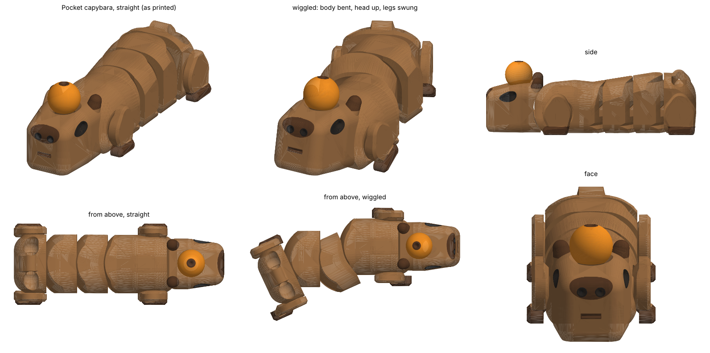

# Fidgets (3D print files)

Two basketball fidgets, a construction nut & bolt, a Southwest Contracting gyro, a
pocket gear fidget and a pocket capybara, each as a **painted 3MF** and a plain single-colour STL. The basketball seams, hazard
stripes and lettering are real 0.6 mm grooves, so they still show when printed in
one colour.


| Fidget | Files | Size (mm) | Hardware |
|---|---|---|---|
| **Basketball gyro**: a ball spinning inside four rings, print-in-place | `stl/basketball-gyro.3mf` / `.stl` | 56 × 56 × 17 | none |
| **Basketball spinner**: three-lobe spinner with a basketball on each lobe | `stl/basketball-spinner.3mf` (body and 2 caps on one plate), or `stl/basketball-spinner.stl` + 2 × `stl/basketball-spinner-cap.stl` | 80 × 73 × 7 | one 608 bearing (22 × 8 × 7, the skateboard kind) |
| **Construction nut & bolt**: three hazard-striped nuts that spin up and down a chunky bolt | `stl/construction-nut-bolt.3mf` (bolt and 3 nuts on one plate), or `stl/construction-bolt.stl` + 3 × `stl/construction-nut.stl` | bolt 32 × 28 × 57, nuts 30 × 26 × 12 | none |
| **Southwest Contracting gyro**: the gyro with SOUTHWEST / CONTRACTING round the outer ring and SWC on the ball | `stl/southwest-contracting-gyro.3mf` / `.stl` | 56 × 56 × 17 | none |
| **Pocket gear fidget**: a sun gear and four planets turning inside a ring cut into a rounded square, SWC on the sun | `stl/pocket-gear-fidget.3mf` / `.stl`, test piece `stl/pocket-gear-fidget-test.3mf` / `.stl` | 52 × 52 × 8 (test 52 × 52 × 4) | none |
| **Pocket capybara**: an articulated capybara with an orange on its head; body wiggles, legs swing, head nods, orange spins | `stl/pocket-capybara.3mf` / `.stl`, test strip `stl/pocket-capybara-test.3mf` / `.stl` | 62 × 24 × 20 (test 34 × 20 × 15) | none |

## Filaments

### Basketball fidgets

Both use the same three filaments in the same slots, so they can share a plate.

| Slot | Filament | Hex | Paints |
|---|---|---|---|
| T1 | Orange | `#E86A1C` | the ball, the lobe faces, the gyro's outer ring |
| T2 | Black | `#1A1A1A` | seams, the 1st and 3rd gyro rings, the spinner body |
| T3 | White | `#F2F2F2` | the 2nd gyro ring |

### Construction nut & bolt

| Slot | Filament | Hex | Paints |
|---|---|---|---|
| T1 | Safety yellow | `#F2C200` | the bolt head and yellow nut, stripes on the black nut |
| T2 | Black | `#1A1A1A` | the hazard stripes, the black nut |
| T3 | Safety orange | `#FF6A13` | the orange nut |
| T4 | Steel grey | `#8C9096` | the threaded shank |

### Southwest Contracting gyro

Placeholder colours until we have the company's; change `FILAMENTS` in
`make_swc_gyro.py` and re-run.

| Slot | Filament | Hex | Paints |
|---|---|---|---|
| T1 | Black | `#1A1A1A` | the outer ring and the innermost ring |
| T2 | Safety orange | `#FF6A13` | all the lettering, the second ring |
| T3 | White | `#F2F2F2` | the ball, the third ring |

### Pocket gear fidget

| Slot | Filament | Hex | Paints |
|---|---|---|---|
| T1 | Black | `#1A1A1A` | the plate, the SWC lettering |
| T2 | Safety orange | `#FF6A13` | the gears |
| T3 | White | `#F2F2F2` | the hubs |

### Pocket capybara



A chunky capybara lying on its belly with an orange on its head, printed flat in
one piece. It is 61.6 mm from nose to rump, 23.8 mm across the legs, and the back
rises from 14 mm at the shoulders to 16 mm over the rump (20.2 mm to the top of the
orange). Ten separate bodies come off the plate already linked:

- **Body:** four segments that wiggle 29° each way at three joints. Each segment
  ends in a ball centred on the joint's upright axis and the next one starts with
  the matching socket, so the seam over the back stays a thin line when it bends.
  Inside the ball the next segment hooks over a rim, and a V ridge in the socket
  rides in a groove round the ball, so the joint can't pull apart or lift out.
- **Legs:** a thigh and paw each side, hind bigger than front, swinging a full
  circle on a pin whose flange is hidden under the leg's closed outer skin.
- **Head:** nods 18° each way and stops on solid material both ways.
- **Orange:** an 8 mm ball that spins on a 4.5 mm shaft running down through the
  head to a flared foot on the bed, so it can't be pulled off.
- **Keyring eye:** a low hump on the rump with a 3 mm hole. Set `KEYRING_D = 0` to
  leave it off; the script checks that version on every run too. A chain or clasp
  suits it better than a big split ring, which can't lie back far enough.

**Print the test strip first.** `pocket-capybara-test` is a head stub on its hinge,
the first body segment, the front of the second and one front leg: the same body
joint, leg pin and head hinge as the full model, in a fraction of the time. It does not
include the orange's shaft.

- Print flat, as it comes. **No supports** (they would weld the joints solid).
- 0.16 mm layers (0.2 works), first layer no thicker than 0.2 mm, 3 walls, 15% infill.
- **Turn on elephant-foot compensation** (0.15 mm). The bodies are 0.6 mm apart at
  the bed and 0.35-0.4 mm apart above it, and a squished first layer is what fuses them.
- Slow the first layer and keep the plate clean: each leg stands on its own on
  17 mm² until the print is done. No brim (it would bridge the seams).
- On the AMS/U1 a prime tower is needed for the four colours. In one colour the
  eyes, nostrils and mouth still show as pits.
- When it comes off the plate: bend each body joint side to side until it cracks
  free, twist each leg, rock the head, then free the orange by pushing its foot
  up from underneath before turning it.
- If the test strip stays fused, raise `CLEAR` in `make_capybara.py` from 0.35 to
  0.45 and `G_SEAM` from 0.4 to 0.5. Re-run and reprint the strip.

The script (about five minutes) won't write the files unless all of its checks
pass. The main lines of its report, with the mirrored legs and joints left out:

```
pocket capybara: 10 separate bodies, each starting on the bed with no layer starting in mid-air; tightest gap as printed 0.35 mm, in the first layer 0.62 mm
   front left leg   full circle      tightest gap 0.35 mm; at least +45/-45 with body joint 1 anywhere from -29 to +29 (every 2.5)
   hind left leg    full circle      tightest gap 0.35 mm; at least +45/-45 with body joint 3 anywhere from -29 to +29 (every 2.5)
   orange           full circle      tightest gap 0.50 mm
   body joint 3     +29/-29 deg      tightest gap 0.29 mm; the wrong way it folds up 8, down 2.5 and twists 6 deg at most
   head nod         +18/-18 deg      tightest gap 0.13 mm; stopped both ways before 30
   legs: 17.3 mm2 or more of bed under each; held on by 1.11 mm of flange each side
   curled and S-bent with every joint at its limit, either way: nothing collides
   every part is held in whichever way it is pulled
   overhang past 45 deg 0.00 mm2; nothing below the bed
   keyring eye: web 4.50 thick at its thinnest, 2.05 over the hole's peak, top at 17.47 (limit 17.5)
   nose to rump 61.6, width 23.8, height 20.2 (top of the keyring eye 17.5)
   paint: 24 patches cut along their edges, the smallest 3.4 mm2 (T1 8581 mm2, T2 378 mm2, T3 35 mm2, T4 170 mm2)
   written file: 10 closed shells for 10 bodies, no triangle without area
pocket-capybara  61.6 x 23.8 x 20.2 mm  12.2 cm3  66280 tris
```

It also lists every wall and pin it measures on the solids (thinnest wall 0.81 mm,
thinnest pin 2.52 mm), and reloads the written STL to count its shells.

**Known limits.** Nothing here has been printed yet. Independent reviews of the
model found no blocker, but these remain:

- Each body joint can also fold upwards about 8° and twist about 6°, so held by
  the shoulders the rump hangs a little.
- The leg pin narrows to 2.2 mm in the short play gap just before its flange, under
  the 2.5 mm the check enforces along the rest of the pin, and the flange holds
  mostly at the sides and little straight above the pin. Pry a paw outwards hard
  and the leg is what breaks.
- The head's stops leave only about 0.13 mm to spare at 15°, so a printer that
  over-extrudes will give a smaller nod.
- Looks: from the front three-quarter view it reads as a capybara; from the side
  the flanks show a slot at each joint and the back steps up either side of the
  centre line, and the face is closer to a pig's snout than it should be.

## Changing them

Every dimension is a constant at the top of `make_fidgets.py` (ball size, ring
count and thickness, clearances, lobe size, bearing size, colours) or
`make_nut_bolt.py` (thread size and pitch, clearance, nut and head size, stripes,
colours). Then:

```bash
python3 make_fidgets.py   # basketball fidgets: writes stl/basketball-*
python3 make_nut_bolt.py  # nut & bolt: writes stl/construction-*  (about a minute)
python3 make_swc_gyro.py  # Southwest Contracting gyro: writes stl/southwest-contracting-*
python3 make_gear_fidget.py  # pocket gear fidget and its test piece  (about a minute)
python3 make_capybara.py  # pocket capybara and its test strip  (about five minutes)
python3 preview.py        # redraws the preview images from the 3MFs
```

Needs `pip install numpy trimesh manifold3d matplotlib`, plus `fonttools qrcode`
for the lettering (it uses the Inter font and text code from `reviewstand/`).

Before writing anything, `make_fidgets.py` turns every gyro pivot through a full
circle and stops if a ring jams or comes apart from its pins:

```
gyro: every pivot turns a full circle, tightest gap 0.35 mm
```

and `make_nut_bolt.py` screws a nut along the whole bolt and stops if it binds:

```
nut & bolt: a nut runs the full thread, tightest gap 0.36 mm
```
