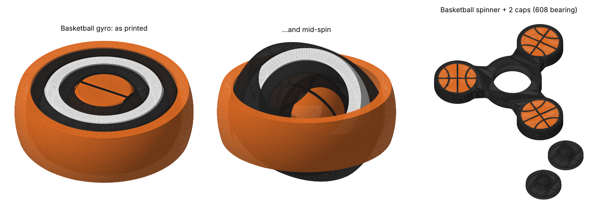
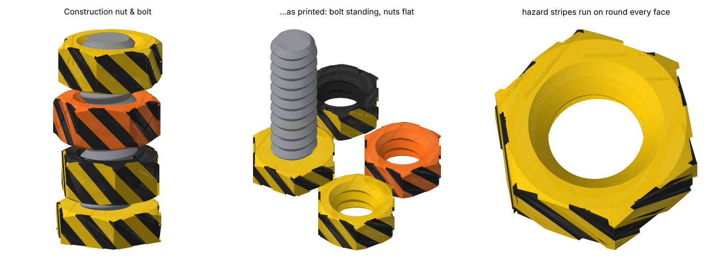
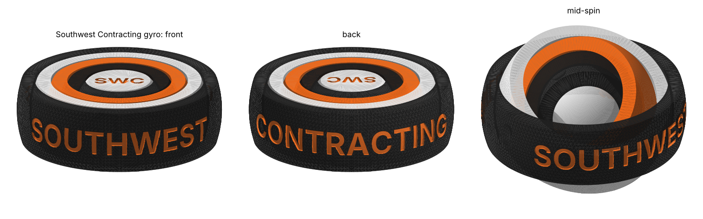
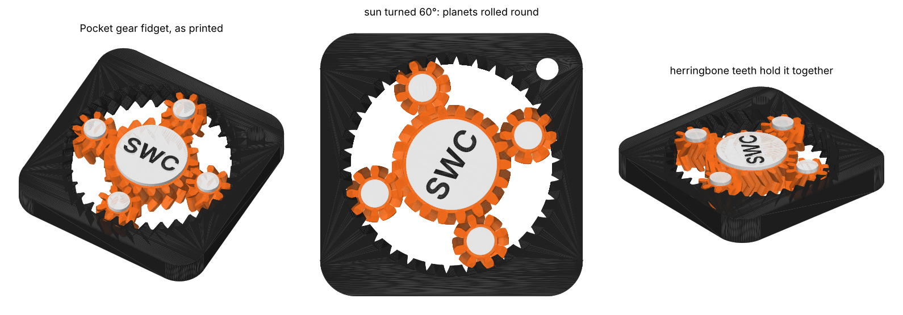

# Fidgets (3D print files)

Two basketball fidgets, a construction nut & bolt, a Southwest Contracting gyro and a
pocket gear fidget, each as a **painted 3MF** and a plain single-colour STL. The basketball seams, hazard
stripes and lettering are real 0.6 mm grooves, so they still show when printed in
one colour.



| Fidget | Files | Size (mm) | Hardware |
|---|---|---|---|
| **Basketball gyro**: a ball spinning inside four rings, print-in-place | `stl/basketball-gyro.3mf` / `.stl` | 56 × 56 × 17 | none |
| **Basketball spinner**: three-lobe spinner with a basketball on each lobe | `stl/basketball-spinner.3mf` (body and 2 caps on one plate), or `stl/basketball-spinner.stl` + 2 × `stl/basketball-spinner-cap.stl` | 80 × 73 × 7 | one 608 bearing (22 × 8 × 7, the skateboard kind) |
| **Construction nut & bolt**: three hazard-striped nuts that spin up and down a chunky bolt | `stl/construction-nut-bolt.3mf` (bolt and 3 nuts on one plate), or `stl/construction-bolt.stl` + 3 × `stl/construction-nut.stl` | bolt 32 × 28 × 57, nuts 30 × 26 × 12 | none |
| **Southwest Contracting gyro**: the gyro with SOUTHWEST / CONTRACTING round the outer ring and SWC on the ball | `stl/southwest-contracting-gyro.3mf` / `.stl` | 56 × 56 × 17 | none |
| **Pocket gear fidget**: a sun gear and four planets turning inside a ring cut into a rounded square, SWC on the sun | `stl/pocket-gear-fidget.3mf` / `.stl`, test piece `stl/pocket-gear-fidget-test.3mf` / `.stl` | 52 × 52 × 8 (test 52 × 52 × 4) | none |

## Filaments

### Basketball fidgets

Both use the same three filaments in the same slots, so they can share a plate.

| Slot | Filament | Hex | Paints |
|---|---|---|---|
| T1 | Orange | `#E86A1C` | the ball, the lobe faces, the gyro's outer ring |
| T2 | Black | `#1A1A1A` | seams, the 1st and 3rd gyro rings, the spinner body |
| T3 | White | `#F2F2F2` | the 2nd gyro ring |

### Construction nut & bolt

| Slot | Filament | Hex | Paints |
|---|---|---|---|
| T1 | Safety yellow | `#F2C200` | the bolt head and yellow nut, stripes on the black nut |
| T2 | Black | `#1A1A1A` | the hazard stripes, the black nut |
| T3 | Safety orange | `#FF6A13` | the orange nut |
| T4 | Steel grey | `#8C9096` | the threaded shank |

### Southwest Contracting gyro

Placeholder colours until we have the company's; change `FILAMENTS` in
`make_swc_gyro.py` and re-run.

| Slot | Filament | Hex | Paints |
|---|---|---|---|
| T1 | Black | `#1A1A1A` | the outer ring and the innermost ring |
| T2 | Safety orange | `#FF6A13` | all the lettering, the second ring |
| T3 | White | `#F2F2F2` | the ball, the third ring |

### Pocket gear fidget

| Slot | Filament | Hex | Paints |
|---|---|---|---|
| T1 | Black | `#1A1A1A` | the plate, the SWC lettering |
| T2 | Safety orange | `#FF6A13` | the gears |
| T3 | White | `#F2F2F2` | the hubs |

The 3MFs use Bambu Studio's painting format, so they open the same in Bambu Studio
(P1S + AMS), OrcaSlicer and Snapmaker Orca (U1).

## Basketball gyro

It prints in one piece and comes off the plate already assembled: the ball pivots
in ring 1 on two cone pins, ring 1 pivots in ring 2 at 90° to that, and so on out.
Spin the ball with a finger, or flick the outer ring and let the rings tumble.

- Print it flat, as it comes. **No supports** (they'd fill the gaps and weld it
  solid). The steepest overhang is the underside of the ball, at 45°.
- 0.2 mm layers, 3 walls, 15% infill. Turn off "ironing" and keep the first layer
  from being over-squished: the rings are 0.6 mm apart on the bed.
- When it comes off the plate, hold the outer ring and gently twist each ring in
  turn until it frees up. A few spins and it loosens.
- Pins have 0.35 mm of clearance all round. If yours fuse, raise `PIN_CLEAR` to
  0.45 (and `GAP` to 0.7) in `make_fidgets.py` and re-run; if they're sloppy,
  drop it to 0.3.

## Basketball spinner

- Print the body flat. The seams on the underside are grooves on the bed face, so
  they print as clean first-layer lines. No supports.
- Use 4 walls and 40%+ infill: the lobes are the weight, and heavier spins longer.
- Print the caps flat face down (the orange basketball face is on the bed), peg up.
- **Assembly:** press the 608 bearing into the hub (it's a 22.15 mm press fit;
  a vice or a table edge helps). Then push a cap into the bearing from each side.
  Each cap only touches the bearing's inner race, so the body spins freely.
- For a longer, quieter spin, wash the grease out of the bearing with
  isopropyl alcohol first.
- If the bearing is loose, glue it, or lower `BEARING_FIT`; if it won't go in,
  raise it.

## Construction nut & bolt



A 16 mm bolt with a coarse 4.5 mm-pitch thread and three hex nuts. Spin a nut and it
runs down the thread; stack them, race them, or jam two together and work them
apart. The nuts and the bolt head are wrapped in diagonal hazard stripes that run
on unbroken round all six faces.

- Print the bolt **standing up, head down**, and the nuts flat. No supports: the
  thread flanks are 44° from vertical.
- 0.16–0.2 mm layers make a smoother thread. 3 walls, 20% infill.
- The nut's thread is 0.5 mm bigger all round than the bolt's (0.36 mm square to
  the flank). If the nuts are stiff, raise `CLEAR` in `make_nut_bolt.py` to 0.6;
  if they wobble, drop it to 0.4. Both ends of each nut have a lead-in chamfer,
  so either side starts on the bolt.
- The 3MF has the bolt and all three nuts painted on one plate: a yellow nut and an
  orange nut with black stripes, and a black nut with yellow stripes.

## Southwest Contracting gyro



The basketball gyro, branded. **SOUTHWEST** runs round the front of the outer ring
and **CONTRACTING** round the back, in Inter Bold, 6.5 mm tall. **SWC** is cut into
both flat faces of the ball, turned so it reads the same whichever face has spun
up. It prints and frees up exactly like the basketball gyro (see above).

The words, monogram, letter sizes, ring colours and filaments are all at the top of
`make_swc_gyro.py`. Each word can span up to about 150° of the ring; a longer one is
shrunk to fit.

## Pocket gear fidget



A 52 mm rounded square, 8 mm thick, with a keyring hole in one corner. Turn the
big sun gear in the middle (with **SWC** on its hub) and the four planet gears roll
round it, spinning as they go, inside a ring of teeth cut into the plate.

**Why there are no axles.** A print-in-place gear on an axle has to be held down by
something printed *over* it: a bridge of plastic across the gear with a hair of air
underneath, and that fuses solid. Instead the teeth are **herringbone** (each tooth
is a V up the face of the gear), so every gear is locked top and bottom by the gears
it meshes with. Everything sits on the bed and nothing is printed over anything.

**Print the test piece first.** `pocket-gear-fidget-test` is the same gears and the
same clearance at 4 mm tall: about a third of the print time, and it tells you
whether the gears free up on your printer.

- Print flat, as it comes. **No supports.**
- 0.12–0.16 mm layers; the teeth are small. 3 walls, 15% infill.
- **Turn on elephant-foot compensation** (0.15 mm) in the slicer. The gears stand
  0.3 mm apart, and a squished first layer is what fuses them.
- When it comes off the plate, twist the sun firmly back and forth until it breaks
  free. A few turns and it runs smoothly.
- If it stays stuck, raise `CLEAR` in `make_gear_fidget.py` from 0.4 to 0.5. If
  it's rattly, drop it to 0.35. Re-run and reprint the test piece.

The script won't write the files unless all of these pass:

```
pocket-gear-fidget: turns a full revolution of the sun, tightest gap 0.31 mm; every gear held in; overhang past 45 deg 0.00 mm2
   thinnest: tooth tip (planet) 0.85, tooth tip (sun) 0.85, plate wall at the sides 3.11, keyring loop 1.73, monogram strokes 0.82
```

That is: each gear is its own piece; turning the sun a full revolution (planets
rolling and spinning by their gear ratios) never makes two gears touch; lifting any
gear 1 mm runs it into its neighbours, so none can fall out; no surface overhangs
past 45°; and no tooth tip, wall or letter stroke is under 0.8 mm.

## Changing them

Every dimension is a constant at the top of `make_fidgets.py` (ball size, ring
count and thickness, clearances, lobe size, bearing size, colours) or
`make_nut_bolt.py` (thread size and pitch, clearance, nut and head size, stripes,
colours). Then:

```bash
python3 make_fidgets.py   # basketball fidgets: writes stl/basketball-*
python3 make_nut_bolt.py  # nut & bolt: writes stl/construction-*  (about a minute)
python3 make_swc_gyro.py  # Southwest Contracting gyro: writes stl/southwest-contracting-*
python3 make_gear_fidget.py  # pocket gear fidget and its test piece  (about a minute)
python3 preview.py        # redraws the preview images from the 3MFs
```

Needs `pip install numpy trimesh manifold3d matplotlib`, plus `fonttools qrcode`
for the lettering (it uses the Inter font and text code from `reviewstand/`).

Before writing anything, `make_fidgets.py` turns every gyro pivot through a full
circle and stops if a ring jams or comes apart from its pins:

```
gyro: every pivot turns a full circle, tightest gap 0.35 mm
```

and `make_nut_bolt.py` screws a nut along the whole bolt and stops if it binds:

```
nut & bolt: a nut runs the full thread, tightest gap 0.36 mm
```
