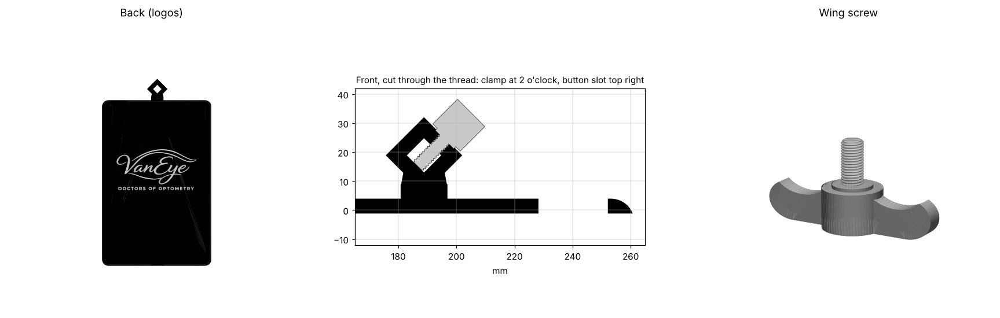

# iPad holder: threaded clamp, wing screw, logos



```bash
pip install trimesh manifold3d matplotlib
python ipad_holder/make_holder.py
```

Reads `source_ipad_holder.3mf` and the two logo SVGs, and writes:

| file | what |
|---|---|
| `ipad_holder.3mf` | the holder, as one object with two parts: the black body (filament 1) and the white VanEye logo (filament 2) |
| `wing_screw.3mf` / `.stl` | a printed M5 wing screw ("butterfly key"), if you have no steel one |

## The diamond loop

The loop is a true diamond: the opening is a square stood on its point,
12 mm across and 12 mm tall, point to point (`DIAMOND`), about 8.5 mm along
each inside face. Its walls are 5 mm (`LOOP_WALL`). Below the opening the
loop is filled out to the neck's full 16 mm width, so it does not hang from
a narrow waist. Earlier versions grew the source's loop instead, which left
a 7.2 mm opening with a flat bottom.

## The top

The top is what hangs on the post, so it is built stronger than the source's:
the top wall is 5 mm thick instead of 3 (`TOP_THICKER`, grown outward so the
pocket keeps its size), the neck is 16 mm wide instead of 12 (`NECK_W`), and
the neck and loop run the case's full 13.3 mm thickness instead of stopping
1.5 mm short of the front.

## Pocket size

The pocket is 5 mm taller (`POCKET_LONGER`) and 1.5 mm deeper
(`POCKET_DEEPER`) than the source's, for a looser fit:

| | source | now |
|---|---|---|
| pocket height, inside | 204.0 mm | 209.0 mm |
| pocket depth, floor to lip | 7.8 mm | 9.3 mm |
| case height, without the loop | 210.5 mm | 215.5 mm |
| case thickness | 11.8 mm | 13.3 mm |

The bottom half of the frame moves down through the plain side walls, and
the lip and front face move up, so the loop, top button slot and the home
button's place against the bottom wall all follow. The logos move down with
the bottom.

## The thread

The source's 5.2 mm hole at 9 o'clock is filled. The thread is now an
**M5 x 0.8** (60°, right hand) through the upper-right wall, square to the
wall so the wings seat flat. It is sized for a bought **steel M5 wing
screw** (major 5.20, minor 4.25): a steel M5 overlaps it by 0.375 mm and
clears its flanks by 0.05 mm (`FLANK_CLEAR`), so it bites into the printed
thread and holds. The 5 mm wall gives about six turns of engagement. Any
steel M5 wing screw with at least 10 mm of thread works; up to about 13 mm
of thread can go in before the tip meets the far side of the opening.

The hole runs sideways through the print, so its thread is stepped by the
layers. An earlier version opened it up (minor 4.35, 0.12 mm flanks) so a
printed screw would turn easily, and the printed screw could be pulled
straight out. A finer layer height on the case, 0.12 or 0.16 mm, makes the
thread cleaner.

It sits at 2 o'clock, at least 0.5 mm clear of the lower-right wall as the
screw goes in (`SCREW_GAP`). The screw can reach 8.4 mm into
the opening before it meets the far wall, so it clamps anything at least
about 4 mm across.

The script checks the fit every run. It turns the screw head a full
revolution in 5° steps against the holder, then pushes a rod the screw's
diameter across the opening. At 2 o'clock the wings point up and away. The
lowest wing tip clears the frame by 10.1 mm, so the longer neck that 9 o'clock
needed has gone (`LOOP_RAISE` = 0). The neck runs 1 mm into the frame wall,
because in the source file it only touched the frame and was a separate
solid.

## Rounded edges

The case's four corners are rounded to 8 mm, seen from the front
(`CORNER_R`). The pocket's two closed corners on the left are rounded to
5 mm about the same centres (`POCKET_R`), so the wall stays 3 mm all the way
round. The right side is open below the lip, so it has no inside corners.
The front and back perimeter edges are rounded over by 1.5 mm (`EDGE_R`).

## Camera hole

The source's front-camera keyhole in the top lip, and the notch below it in
the top wall, are filled in flush with the wall and lip (`CAMERA_X`).

## Home button

The source's 10 mm hole sat 4.7 mm below where an iPad mini's home button
is. It is filled. A new opening is cut where the button actually sits: the
iPad slides in against the left wall and rests on the bottom wall, and its
button is centred in the 21 mm bottom bezel, 10.6 mm up from its bottom edge
(`HOME_CENTRE`, x 188.4, y −199.5). Against the screen the opening is a
slot with rounded ends, 19 mm wide (`HOME_HOLE_W`) and 15 mm tall
(`HOME_HOLE_D`), for an 11 mm button, and the lip slopes away from it at 30°
(`HOME_SLOPE`) to 25.6 × 21.6 mm at the front face. That leaves 2 mm of flat
lip below it. Apple publishes no exact button position, so this is worked
out from the body and screen sizes.

## Colours

The body is black (`BODY_RGB`) and the VanEye inlay white. The 3MF carries
Bambu Studio / OrcaSlicer settings that put the body on filament 1 and the
logo on filament 2 and set those filaments' colours, so it opens coloured.
The printyours.ca logo is etched, so it is the body's colour.

## Front accent lines

Off by default (`FRONT_LINES = False`), so the front is plain black. Turned
on, white lines run round the four corners of the front face: 0.8 mm wide, 3 mm
in from the edge, following the rounded outline for 35 mm along each side
from each corner (`LINE_*`). They are the top 0.4 mm of the print, so they
are the last two layers, in their own part and filament. They stay 0.7 mm
clear of every edge and opening. `front_lines_mockup.png` shows them against
the other styles that were considered.

## Power button

A slot runs through the top wall and its lip in the top-right corner (seen
from the front), from the pocket floor and open to the front, so a finger
reaches the iPad mini's top button. It spans 9 to 33 mm in from the frame's
right outside edge (`POWER_SLOT`). That is generous, because Apple publishes no
exact position for the button.

## The wing screw

The thread is 13 mm long, which covers the 5 mm wall plus 8 of the 8.4 mm
the screw can reach into the opening. The head is a third bigger than the
first version's: the wings span 40 mm (`WING_SPAN`) and are 4 mm thick, on a
13.3 mm hub, so it is easier to grip. Print it head down, with the
wings flat on the bed and the thread pointing up. That way the thread prints
round, with no supports. Its thread is a shade under a steel M5's (4.90
major) so it turns in the printed hole without binding. A steel wing screw
holds better; the printed one is there if you have none.

## The logos

Both logos sit in the back face, the face on the bed, and are mirrored so
they read correctly from behind.

- **VanEye** is a 0.4 mm inlay (two 0.2 mm layers) and its own part, so in
  the slicer you give it its own filament.
- **printyours.ca** is etched: a 0.4 mm recess in the body's own colour
  (`ETCH_DEPTH`). It is 55 mm wide, up from 42 mm so the lettering reads.

Change the size, position or kind (`"inlay"` or `"etch"`) with `LOGOS` in
`make_holder.py`.
