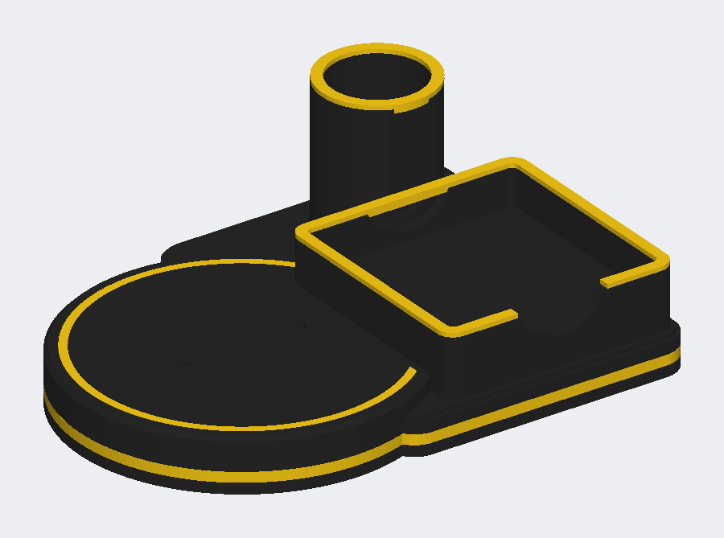

# Mascot desk stand: stage, sticky-note tray, pen cup



The base the mascot figure stands on, with the sticky-note tray and pen cup
beside it and yellow trim, as in the concept render. The figure itself is
printed separately and screwed down onto the round stage.

```bash
pip install manifold3d pillow
python mascotstand/make_mascot_stand.py
```

Files are in `models/`:

| file | what it is | print in |
|---|---|---|
| `mascot_stand_base.3mf` / `.stl` | the whole stand, one piece, 190 x 140 x 64 mm | black |
| `mascot_stand_trim.3mf` | all four trim pieces on one plate, ~11 g | yellow |
| `mascot_stand_trim_*.stl` | the same pieces one at a time, to reprint one | yellow |
| `mascot_stand_assembled.3mf` | base and trim together, coloured, to look at | — |

## Why two prints instead of one AMS print

The trim sits at five different heights (bottom band, stage, tray rim, cup
rim) on a part 64 mm tall. Painted in with the AMS, nearly every layer of the
base would have a black/yellow swap, and on a P1S each swap flushes filament
into the poop chute. Printed as two plates there are **no swaps and no purge
at all**: the base is one black print, and the trim is one yellow print that
presses into slots in the base.

## Printing (P1S)

* **Base:** as it lies, bottom down, no supports. 0.2 mm layers, 2–3 walls,
  15% infill is plenty. It fits the bed with room to spare.
* **Trim:** as it lies on its plate. The pieces nest inside each other, so it
  is one small plate. The two rims are upside down on purpose: flat top on
  the bed, tongue up.

## Fitting the trim

* **Tray rim / cup rim:** the tongue drops into the slot in the top of the wall.
* **Stage ring:** presses into the groove round the top of the disc.
* **Side band:** open at the back left. Start at one end and work it round
  the groove in the outside wall.

Clearance is 0.12 mm a side (`--fit`). If a piece is loose, a few dots of
CA glue; if it won't go in, regenerate with `--fit 0.18`.

## Fixing the figure on

Two M4 countersunk holes go up through the stage from underneath, 44 mm
apart, centred on the stage. Put matching M4 heat-set inserts (or tapped
holes) in the figure's boots and screw it down from below — the heads sit
3 mm up inside the base so it still sits flat. Match them to your figure
with `--boot-spacing`, `--dog-x` and `--dog-y`. Or skip the screws and glue
it.

The underside also has six 10 mm recesses for rubber bump-on feet
(`--foot-d 0` to leave them off).

## Sizes

* Tray takes a standard 3 x 3 in (76 mm) sticky pad, 14 mm deep, with a
  finger notch in the front. `--pad 102` for 4 x 4 in pads.
* Pen cup is 34 mm across inside and 54 mm deep (`--cup-r`, `--cup-h`).
* Stage is 124 mm across (`--disc-r`).

Run with `--help` for everything.
