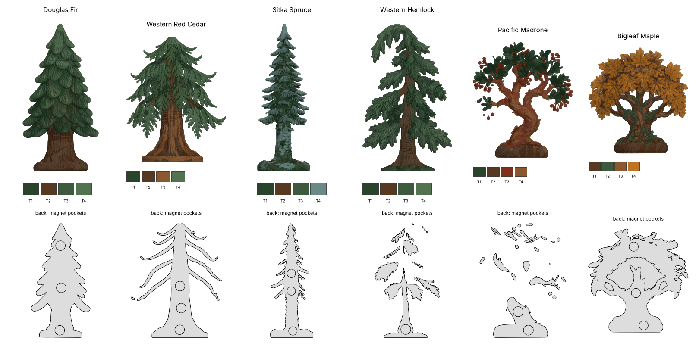

# Pacific Northwest tree magnets (3D print files)

Six stylized trees generated with hi3D (`*.png` source image → `*.glb` textured model),
cut in half front to back by `make_magnets.py` so they lie flat on the fridge, with
hidden magnets in the flat back.

Each half comes as a **painted 3MF for a 4-toolhead printer** (Snapmaker U1) and as a
plain single-colour STL.

| Files | W × H (mm) | Sticks out | Magnets | Cut moved back | Plastic (solid) |
|---|---|---|---|---|---|
| `stl/douglas-fir-half.stl` + `-lids.stl` | 39 × 75 | 21 mm | 3 × 6×3 mm | 0 mm | 13.7 cm³ |
| `stl/western-red-cedar-half.stl` + `-lids.stl` | 60 × 75 | 24 mm | 3 × 6×3 mm | 0 mm | 10.3 cm³ |
| `stl/sitka-spruce-half.stl` + `-lids.stl` | 27 × 75 | 14 mm | 3 × 5×2 mm | 1 mm | 4.7 cm³ |
| `stl/western-hemlock-half.stl` + `-lids.stl` | 46 × 75 | 20 mm | 1 × 6×3 mm | 2 mm | 7.6 cm³ |
| `stl/pacific-madrone-half.stl` + `-lids.stl` | 65 × 75 | 23 mm | 2 × 6×3 mm | 2 mm | 10.1 cm³ |
| `stl/bigleaf-maple-half.stl` + `-lids.stl` | 69 × 73 | 23 mm | 3 × 6×3 mm | 0 mm | 21.1 cm³ |

**Magnets to buy:** 14 × 6×3 mm and 3 × 5×2 mm neodymium discs (the spruce is too slim
for 6 mm). The hemlock only has solid plastic for one; it's light enough that one holds it.

## Colour (`stl/*-half.3mf`)

Every triangle carries its filament (`paint_color`, the per-triangle painting that
OrcaSlicer and Snapmaker Orca read), taken from the hi3D texture nearest it. The texture
has shadows baked into its crevices; those triangles take the colour of the surface around
them instead of turning black. Lone specks are smoothed away, so the printer isn't swapping
toolheads for single triangles.

All six trees share one set of 8 filaments, and each tree uses the 4 that suit it best:

| Filament | Hex | Used by |
|---|---|---|
| Dark forest green | `#2A442C` | fir, cedar, spruce, hemlock, madrone |
| Dark brown | `#573821` | all six |
| Brick red | `#7E311A` | madrone (bark, berries) |
| Pine green | `#3D5A3E` | fir, spruce, hemlock, maple |
| Mid brown | `#8B572F` | cedar, madrone, maple |
| Moss green | `#53724F` | fir, cedar, hemlock |
| Grey-green | `#6B8987` | spruce (bark, needle tips) |
| Golden ochre / amber | `#BD7524` | maple leaves |

| Tree | T1 | T2 | T3 | T4 |
|---|---|---|---|---|
| Douglas fir | dark forest green | dark brown | pine green | moss green |
| Western red cedar | dark forest green | dark brown | mid brown | moss green |
| Sitka spruce | dark forest green | dark brown (barely used) | pine green | grey-green |
| Western hemlock | dark forest green | dark brown | pine green | moss green |
| Pacific madrone | dark forest green | dark brown | brick red | mid brown |
| Bigleaf maple | dark brown | pine green | mid brown | golden ochre |

Open the 3MF in Snapmaker Orca and set filaments 1–4 as listed (the hex values are
in the file, but your loaded filaments decide what prints). The texture is darker than
hi3D's lit renders, so filaments a shade brighter than the hex values will look closer to
the pictures; a bright yellow in the maple's T4 slot works well.

## How it goes together

- **`-half.stl`** is the front half of the tree. Its flat back has a pocket for each magnet:
  0.3 mm wider than the magnet, and 1.2 mm deeper (a 1 mm lid plus 0.2 mm for glue), with at
  least 1.2 mm of plastic left in front of it.
- **`-lids.stl`** is one thin disc per pocket.

1. Mark which face of each magnet is "out" and put them all in the same way up, so trees next
   to each other don't push apart.
2. Drop a magnet into each pocket with a dot of CA glue, then glue a lid on top. It sits flush
   with the back, so the magnets are hidden and the back sits flat on the fridge.

Where the cut went through gaps between branches the back is open; only the solid areas
touch the fridge, which is enough.

The cut goes through the middle of each tree's base. For the spruce, hemlock and madrone it
was moved 1–2 mm towards the back to leave enough plastic in front of the magnets.

## Printing

- Half: flat back down on the bed. Most of the relief faces up, so it needs few supports;
  0.12 mm layers for the needle detail, 15% infill is plenty.
- Lids: flat, no supports.

To change the size, the magnets or the palette (`TOOLHEADS`, `PALETTE_SIZE`), edit the
constants at the top of `make_magnets.py` and run `python3 make_magnets.py`, then
`python3 preview.py` for the preview sheet, which is drawn from the 3MFs themselves (needs
`pip install trimesh manifold3d shapely fast-simplification scipy matplotlib`).
