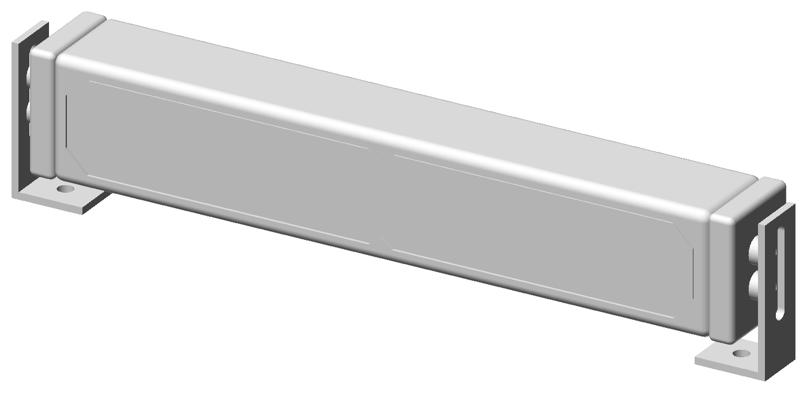

# SS10 Chase light bar, 1:1

A printable model of the SS10 Chase built from its dimension drawing, so it can be
used as a fit-check dummy, a display piece or a mounting mock-up.

```bash
python ss10_chase/make_ss10_chase.py      # needs manifold3d (+ numpy/matplotlib for previews)
```



| File | What | Print |
|---|---|---|
| `ss10_housing.stl` | whole housing, 309.7 × 51.1 × 40.6 mm | lens up, needs a ≥ 310 mm bed |
| `ss10_housing_half_A/B.stl` | the same, cut in two at the centre | lens up; join with two 5 mm × 30 mm dowels and glue |
| `ss10_bracket_inward.stl` | L bracket, feet under the bar | ×2, as exported (L profile on the bed, no supports) |
| `ss10_bracket_outward.stl` | L bracket, feet out past the ends | ×2, as exported |
| `ss10_assembly_*.stl` | everything in place | for checking only |

From the drawing: 11.63" long, 2.01" high, 1.60" deep; housing 10.85" between the
end caps; bracket bolt line 0.93" from the back; 0.67" height adjustment slot;
feet 0.53" below the bar; inward feet span 10.10"–12.43", outward 12.43"–13.44".
The assembled widths come out at exactly 12.43" and 13.44".

Not in the drawing, so estimated: lens outline, corner radii, bracket thickness
(3 mm), bolt spacing (14 mm) and hole sizes (5 mm tap holes for M6 or heat-set
inserts in the caps, 6.5 mm clearance in the brackets). These are constants at
the top of the script, marked `# est.`

The housing is solid; 15–20 % infill with 3 walls is plenty. For outdoor use
print in PETG or ASA.
